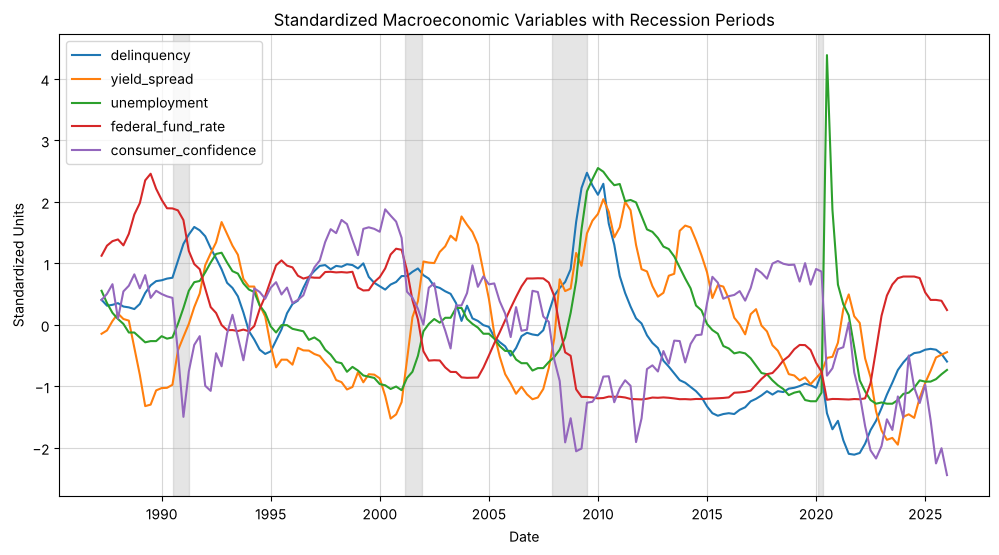
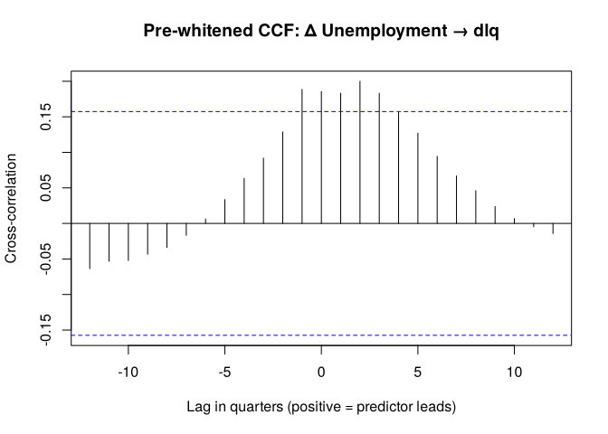
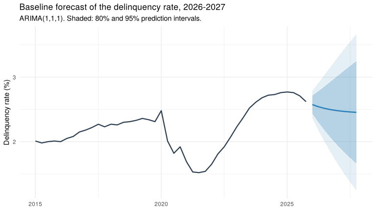

# Forecasting US Consumer Loan Delinquency with Macroeconomic Indicators

> **Status: in progress.** Data pipeline, exploratory analysis, feature engineering and the baseline univariate models are complete. Models with macroeconomic predictors are next (see [Roadmap](#roadmap)).

Consumer loan delinquency is an early signal of household financial stress and of future credit losses for banks. This project asks a simple question: **can macroeconomic conditions help forecast the US consumer loan delinquency rate?** The answer matters to central banks, prudential regulators running stress tests, and lenders setting loss provisions.



## Data

Quarterly data from [FRED](https://fred.stlouisfed.org/), **1987 Q1 – 2025 Q4** (156 quarters). Daily and monthly series are averaged to quarters.

| Variable | FRED ID | Role | Transmission channel |
|---|---|---|---|
| Delinquency rate on consumer loans, all commercial banks | `DRCLACBS` | Target | — |
| Yield spread (10Y – 2Y Treasury) | `T10Y2Y` | Predictor | Monetary policy / market expectations |
| Effective federal funds rate | `FEDFUNDS` | Predictor | Monetary policy |
| Unemployment rate | `UNRATE` | Predictor | Real economy |
| University of Michigan consumer sentiment | `UMCSENT` | Predictor | Household expectations |

## Approach

1. **Exploratory analysis** ([`notebooks/01_eda.ipynb`](notebooks/01_eda.ipynb), Python): how each series behaves over the cycle and in recessions. Delinquency spikes in 1991 and 2008–09 but falls to a record low during COVID-19, reflecting stimulus and forbearance policies.
2. **Feature engineering** ([report](reports/02_feature_engineering.md) · [source](notebooks/02_feature_engineering.Rmd), R):
   - **Stationarity**: Augmented Dickey-Fuller tests. Delinquency and the yield spread are stationary in levels; unemployment, the federal funds rate and consumer confidence are first-differenced.
   - **Seasonality**: Canova-Hansen tests find no seasonal pattern in any series.
   - **Lead-lag structure**: each predictor is pre-whitened with an ARIMA filter before computing cross-correlations with delinquency, so that shared persistence does not create spurious correlations.
3. **Baseline univariate model** ([report](reports/03_baseline_arma.md) · [source](notebooks/03_baseline_arma.Rmd), R): an ARMA in levels vs an ARIMA in differences, compared on rolling-origin forecasts against a naive benchmark, plus tests of how to treat the COVID-19 break. The winner is the benchmark the macro models have to beat.

## Findings so far



- **Unemployment** is the clearest leading signal: a rise in unemployment is followed by higher delinquency in the same quarter and up to three quarters later.
- **The federal funds rate and the yield spread** show no robust short-run lead. Instead, delinquency tends to *precede* them (rate cuts one quarter later, a steeper curve about a year later), which is consistent with policy reacting to credit stress.
- **Consumer confidence** shows no significant lead-lag relationship once pre-whitened.
- The **COVID-19 period** breaks the usual link between the business cycle and delinquency and needs explicit treatment in the models.
- **Baseline:** an **ARIMA(1,1,1)** on the change in delinquency beats both a naive forecast and an ARMA(2,1) in levels at every horizon in rolling out-of-sample forecasts. The ARMA in levels keeps reverting to a long-run mean of 3%, well above post-2008 delinquency (2.4% on average in 2011–2019), but it does better during crises. Anticipating those turning points is the job of the macro predictors.
- **COVID-19** does not change the baseline's dynamics, and a COVID dummy worsens post-COVID forecasts, so the baseline uses the full sample. Pulse dummies will be tested in the multivariate models, where the 2020 unemployment spike is the real problem.



The resulting modeling dataset is saved to [`data/model_data.csv`](data/model_data.csv).

## Roadmap

- [x] Data pipeline from the FRED API
- [x] Exploratory analysis
- [x] Stationarity, seasonality and lead-lag analysis
- [x] Baseline univariate models (ARMA) for delinquency
- [ ] Models with macroeconomic predictors at the lags identified above
- [x] Treatment of the COVID-19 structural break (baseline; pulse dummies to test in the multivariate models)
- [ ] Out-of-sample evaluation (rolling-origin forecasts vs. a naive benchmark)

## Repository structure

```
├── data/
│   ├── data.csv              # quarterly dataset built from FRED
│   └── model_data.csv        # stationary, model-ready dataset
├── notebooks/
│   ├── 01_eda.ipynb          # exploratory analysis (Python)
│   ├── 02_feature_engineering.Rmd   # stationarity, seasonality, CCF (R)
│   └── 03_baseline_arma.Rmd         # baseline model and COVID treatment (R)
├── reports/
│   ├── 02_feature_engineering.md    # rendered R Markdown, readable on GitHub
│   ├── 03_baseline_arma.md
│   └── figures/
├── src/
│   └── build_dataset.py      # downloads FRED series and builds data/data.csv
├── requirements.txt
└── .env.example
```

## How to reproduce

The processed data is included, so the notebooks run without an API key.

```bash
# Python
pip install -r requirements.txt
jupyter notebook notebooks/01_eda.ipynb

# R (from the notebooks/ folder)
install.packages(c("forecast", "xts", "ggplot2", "readr", "dplyr", "tseries", "urca", "knitr", "kableExtra", "rmarkdown"))
rmarkdown::render("02_feature_engineering.Rmd")
rmarkdown::render("03_baseline_arma.Rmd")
```

To refresh the data from FRED, get a free [API key](https://fred.stlouisfed.org/docs/api/api_key.html), copy `.env.example` to `.env`, add your key, and run `python src/build_dataset.py`.

## Author

**Farida Issifou** · MSc Applied Economics (Data Science), University of Neuchâtel
