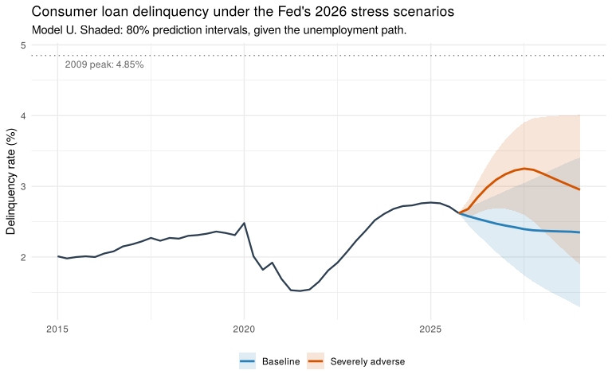
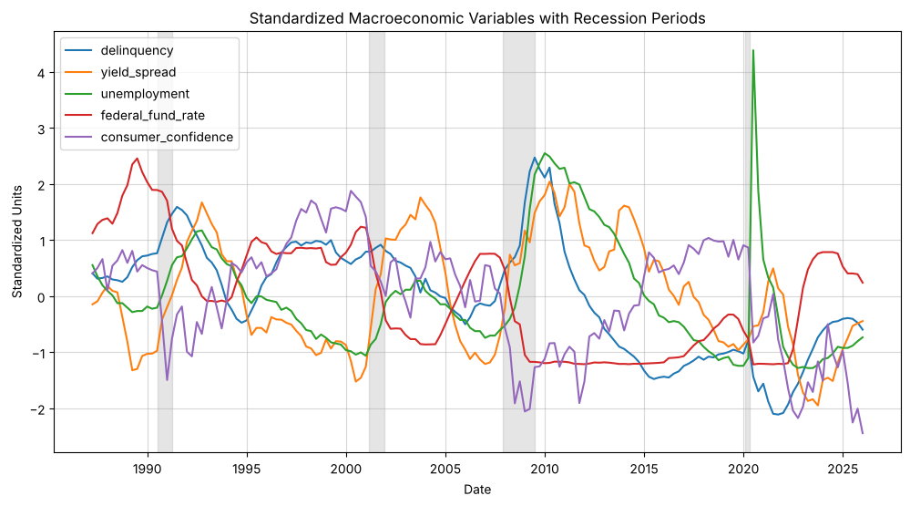
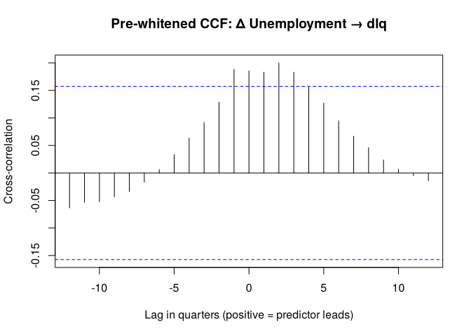

# Forecasting US Consumer Loan Delinquency with Macroeconomic Indicators

> **Status: complete.** Data pipeline, analysis, stress-scenario forecasts and a policy note summarising the findings. Possible extensions are listed at the end.

Consumer loan delinquency is an early signal of household financial stress and of future credit losses for banks. This project asks two questions that matter to lenders setting loss provisions and to supervisors running stress tests:

1. **Does the labour market give an earlier, more accurate warning of rising delinquency than delinquency's own trend?**
2. **What would the Federal Reserve's 2026 stress-test scenarios mean for consumer loan delinquency?**

## Policy note

**[Will Rising Unemployment Push Up Consumer Loan Delinquency? Early Warning Signals and the Fed's 2026 Stress Scenarios](policy_note/policy_note.pdf)** ([LaTeX source](policy_note/policy_note.tex))

The results are reported in a short note for lenders and supervisors, written for the understanding of a general audience, keeping the technical details in an appendix.



**Key takeaways**

- **Watch delinquency itself.** In real time, adding unemployment does not substancially improve forecasts one to four quarters ahead: unemployment moves at the same time as delinquency, so it gives no lead time.
- **Use unemployment for scenario analysis.** Each additional point of unemployment raises delinquency by about **0.15 points** within two quarters.
- **Treat this as a lower bound.** In 2008, the rise in unemployment explains only about half of the surge in delinquency, which started in mortgage and consumer credit before it reached the labour market.
- **Fed 2026 severely adverse scenario** (unemployment peaking at 10% in 2027 Q3, house prices down about 30%): delinquency rises from 2.62% to **3.25%** through job losses alone, and to around **3.9%** once a 2008-type housing and credit shock is accounted for. Under the baseline, it eases to about 2.35% by 2029 Q1.
- **Policy support can break the link.** During COVID-19, unemployment jumped by 9 points while delinquency fell to a record low, thanks to stimulus and forbearance.

## Data

Quarterly data from [FRED](https://fred.stlouisfed.org/), **1987 Q1 – 2025 Q4** (156 quarters). Daily and monthly series are averaged to quarters. Stress scenarios are the Fed's [2026 final supervisory scenarios](https://www.federalreserve.gov/supervisionreg/dfa-stress-tests-2026.htm) (domestic baseline and severely adverse, 2026 Q1 – 2029 Q1).

| Variable | FRED ID | Role | Transmission channel |
|---|---|---|---|
| Delinquency rate on consumer loans, all commercial banks | `DRCLACBS` | Target | — |
| Yield spread (10Y – 2Y Treasury) | `T10Y2Y` | Predictor | Monetary policy / market expectations |
| Effective federal funds rate | `FEDFUNDS` | Predictor | Monetary policy |
| Unemployment rate | `UNRATE` | Predictor | Real economy |
| University of Michigan consumer sentiment | `UMCSENT` | Predictor | Household expectations |



## Approach and results by step

1. **Exploratory analysis** ([`notebooks/01_eda.ipynb`](notebooks/01_eda.ipynb), Python). Delinquency spikes in 1991 and 2008–09 but falls to a record low during COVID-19, reflecting stimulus and forbearance policies.

2. **Feature engineering** ([report](reports/02_feature_engineering.md) · [source](notebooks/02_feature_engineering.Rmd), R). ADF tests for stationarity, Canova-Hansen tests for seasonality (none found), and pre-whitened cross-correlations to find lead-lag relationships. Unemployment is the only predictor with a clear link to delinquency (same quarter up to three quarters later). The fed funds rate and the yield spread tend to *follow* delinquency, consistent with policy reacting to credit stress.

   

3. **Baseline univariate model** ([report](reports/03_baseline_arma.md) · [source](notebooks/03_baseline_arma.Rmd), R). An **ARIMA(1,1,1)** on the change in delinquency beats a naive forecast and an ARMA(2,1) in levels in rolling out-of-sample forecasts (from 2004 Q4, 1 to 4 quarters ahead). The ARMA in levels reverts to a long-run mean of 3%, well above post-2008 delinquency. COVID-19 does not change the baseline's dynamics, so it uses the full sample.

4. **Macro models and stress scenarios** ([report](reports/04_macro_models_stress_test.md) · [source](notebooks/04_macro_models_stress_test.Rmd), R).
   - The baseline plus macro predictors, with pulse dummies for 2020 Q2 – 2021 Q1. Only the change in unemployment (same and previous quarter) and the yield spread matter. The spread's negative sign reflects the Fed's reaction to credit stress, so it is left out of the scenario model.
   - Rolling forecasts with the actual macro path and in real time. In real time, the macro models are no better than the baseline (RMSE 4 quarters ahead 0.417 vs 0.411). With the actual path, the largest gain is in the 2008 crisis (-14%), and it is not statistically significant.
   - A check against 2008, and forecasts under the Fed's 2026 baseline and severely adverse scenarios ([data](data/fed_2026/)).

5. **Policy note** ([PDF](policy_note/policy_note.pdf)): the findings above, for a non-technical audience.

## Repository structure

```
├── data/
│   ├── data.csv              # quarterly dataset built from FRED
│   ├── model_data.csv        # stationary, model-ready dataset
│   └── fed_2026/             # Fed 2026 supervisory scenarios (baseline, severely adverse)
├── notebooks/
│   ├── 01_eda.ipynb                     # exploratory analysis (Python)
│   ├── 02_feature_engineering.Rmd       # stationarity, seasonality, CCF (R)
│   ├── 03_baseline_arma.Rmd             # baseline model and COVID treatment (R)
│   └── 04_macro_models_stress_test.Rmd  # macro models, evaluation, stress scenarios (R)
├── reports/                  # rendered R Markdown, readable on GitHub
│   ├── 02_feature_engineering.md
│   ├── 03_baseline_arma.md
│   ├── 04_macro_models_stress_test.md
│   └── figures/
├── policy_note/
│   ├── policy_note.pdf       # final policy note
│   ├── policy_note.tex       # LaTeX source
│   └── figures/
├── src/
│   └── build_dataset.py      # downloads FRED series and builds data/data.csv
├── requirements.txt
└── .env.example
```

## How to reproduce

The processed data is included, so the notebooks run without an API key.

```bash
# Python
pip install -r requirements.txt
jupyter notebook notebooks/01_eda.ipynb

# R (from the notebooks/ folder)
install.packages(c("forecast", "xts", "ggplot2", "readr", "dplyr", "tseries", "urca", "knitr", "kableExtra", "rmarkdown"))
rmarkdown::render("02_feature_engineering.Rmd")
rmarkdown::render("03_baseline_arma.Rmd")
rmarkdown::render("04_macro_models_stress_test.Rmd")
```

To refresh the data from FRED, get a free [API key](https://fred.stlouisfed.org/docs/api/api_key.html), copy `.env.example` to `.env`, add your key, and run `python src/build_dataset.py`.

## Possible extensions

- **SQL:** store the FRED series and scenario paths in a small database and build the modelling dataset with SQL queries.
- **Dashboard (Tableau / Power BI):** an interactive view of delinquency, unemployment and the scenario forecasts.
- **Credit-side indicators:** test whether banks' lending standards or flows into delinquency give the early warning that unemployment does not, and whether results differ between credit cards and car loans.

## Author

**Farida Issifou** · MSc Applied Economics (Data Science), University of Neuchâtel
