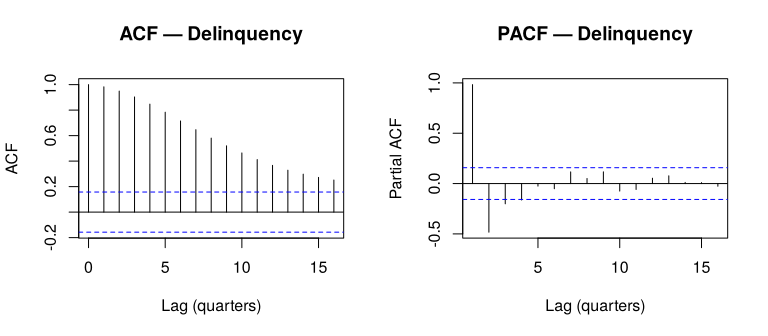
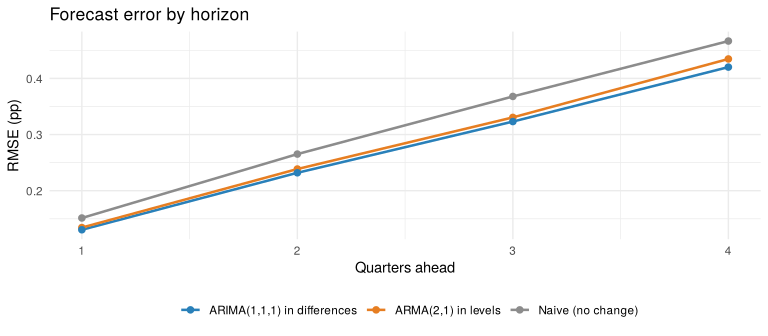
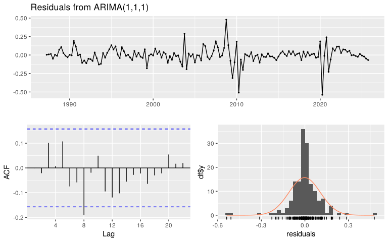
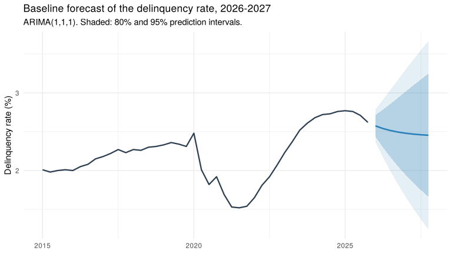

Consumer Loan Delinquency Forecasting: Baseline Univariate Model
================
Farida Issifou
2026-10-27

------------------------------------------------------------------------

Before adding macroeconomic predictors, we need a benchmark: how well
can delinquency be forecast using **only its own past**? The
multivariate models of the next step will have to beat this baseline to
show that the macro variables add information.

This notebook (1) fits an ARMA model in levels, (2) fits an alternative
specification in first differences, (3) compares both on out-of-sample
forecasts, (4) tests how to treat the COVID-19 break, and (5) produces
the final baseline forecasts.

------------------------------------------------------------------------

## Setup

``` r
library(forecast)    # Arima, tsCV, forecast
library(ggplot2)
library(readr)
library(tseries)     # kpss.test
library(urca)        # ur.df (ADF test with or without a trend)
library(knitr)
library(kableExtra)  # table styling
```

``` r
# Arima with a fallback: the default estimation (CSS-ML) occasionally fails on
# short or turbulent samples; exact maximum likelihood is used in that case
fit_arima <- function(y, order, ...) {
  tryCatch(Arima(y, order = order, ...),
           error = function(e) Arima(y, order = order, method = "ML", ...))
}

# Readable tables
show_table <- function(df, caption = NULL) {
  kable(df, caption = caption, align = "l", row.names = FALSE) |>
    kable_styling(bootstrap_options = c("striped", "condensed"), full_width = FALSE)
}

# Fit every ARIMA(p, d, q) up to max_order and rank them by an information criterion
fit_grid <- function(y, d, max_order) {
  out <- data.frame()
  for (p in 0:max_order) for (q in 0:max_order) {
    fit <- tryCatch(fit_arima(y, order = c(p, d, q)), error = function(e) NULL)
    if (is.null(fit)) next
    lb <- Box.test(residuals(fit), lag = 12, type = "Ljung-Box", fitdf = p + q)
    out <- rbind(out, data.frame(
      Model = if (d == 0) sprintf("ARMA(%d,%d)", p, q) else sprintf("ARIMA(%d,%d,%d)", p, d, q),
      AICc  = round(fit$aicc, 1),
      BIC   = round(fit$bic, 1),
      `Residual autocorrelation (Ljung-Box p-value)` = round(lb$p.value, 2),
      check.names = FALSE))
  }
  out
}
```

``` r
# Model-ready dataset from 02_feature_engineering (1987 Q2 – 2025 Q4)
model_data <- read_csv("../data/model_data.csv", show_col_types = FALSE)
dlq <- ts(model_data$dlq, start = c(1987, 2), frequency = 4)
```

We use the same sample as `model_data.csv` (1987 Q2 to 2025 Q4, 155
quarters) so that the baseline and the multivariate models are estimated
on the same quarters.

------------------------------------------------------------------------

## 1. Baseline Specification: ARMA in Levels

Step 2 found the delinquency rate to be stationary in levels, so the
natural starting point is an ARMA(p, q) model on the series itself.

``` r
# as.numeric() so that the lag axis counts quarters
par(mfrow = c(1, 2))
acf(as.numeric(dlq),  lag.max = 16, main = "ACF — Delinquency",  xlab = "Lag (quarters)")
pacf(as.numeric(dlq), lag.max = 16, main = "PACF — Delinquency", xlab = "Lag (quarters)")
```

<!-- -->

``` r
par(mfrow = c(1, 1))
```

The ACF decays slowly, and the PACF has two clear spikes (lags 1 and 2)
before dropping inside the bounds. This points to an AR(2), possibly
with a small MA term.

To choose the order formally, we estimate all ARMA(p, q) models with p
and q up to 4 and rank them by two information criteria, **AICc** and
**BIC**. Both reward fit and penalise extra parameters, so lower is
better (BIC penalises more heavily). We also check that the model leaves
no autocorrelation in its residuals: a Ljung-Box p-value above 0.05
means none is detected.

``` r
grid_levels <- fit_grid(dlq, d = 0, max_order = 4)
show_table(head(grid_levels[order(grid_levels$AICc), ], 5),
           caption = "Five best ARMA models in levels (ranked by AICc)")
```

<table class="table table-striped table-condensed" style="width: auto !important; margin-left: auto; margin-right: auto;">
<caption>
Five best ARMA models in levels (ranked by AICc)
</caption>
<thead>
<tr>
<th style="text-align:left;">
Model
</th>
<th style="text-align:left;">
AICc
</th>
<th style="text-align:left;">
BIC
</th>
<th style="text-align:left;">
Residual autocorrelation (Ljung-Box p-value)
</th>
</tr>
</thead>
<tbody>
<tr>
<td style="text-align:left;">
ARMA(2,1)
</td>
<td style="text-align:left;">
-243.1
</td>
<td style="text-align:left;">
-228.3
</td>
<td style="text-align:left;">
0.26
</td>
</tr>
<tr>
<td style="text-align:left;">
ARMA(4,0)
</td>
<td style="text-align:left;">
-242.3
</td>
<td style="text-align:left;">
-224.6
</td>
<td style="text-align:left;">
0.18
</td>
</tr>
<tr>
<td style="text-align:left;">
ARMA(2,3)
</td>
<td style="text-align:left;">
-241.8
</td>
<td style="text-align:left;">
-221.3
</td>
<td style="text-align:left;">
0.17
</td>
</tr>
<tr>
<td style="text-align:left;">
ARMA(3,2)
</td>
<td style="text-align:left;">
-241.7
</td>
<td style="text-align:left;">
-221.1
</td>
<td style="text-align:left;">
0.30
</td>
</tr>
<tr>
<td style="text-align:left;">
ARMA(4,1)
</td>
<td style="text-align:left;">
-241.5
</td>
<td style="text-align:left;">
-221.0
</td>
<td style="text-align:left;">
0.15
</td>
</tr>
</tbody>
</table>

**ARMA(2, 1)** comes first on both criteria and leaves no residual
autocorrelation.

``` r
model_a <- Arima(dlq, order = c(2, 0, 1))
model_a
```

    ## Series: dlq 
    ## ARIMA(2,0,1) with non-zero mean 
    ## 
    ## Coefficients:
    ##          ar1      ar2      ma1    mean
    ##       1.7850  -0.8056  -0.4129  3.0270
    ## s.e.  0.0713   0.0701   0.1088  0.2303
    ## 
    ## sigma^2 = 0.0114:  log likelihood = 126.74
    ## AIC=-243.47   AICc=-243.07   BIC=-228.26

------------------------------------------------------------------------

## 2. Alternative Specification: ARIMA in First Differences

The step 2 conclusion relies on an ADF test that includes a time trend
(`tseries::adf.test` always adds one). When we run the ADF test without
a trend, or use the KPSS test, the verdict changes:

``` r
adf_trend <- ur.df(dlq, type = "trend", lags = 8, selectlags = "AIC")
adf_drift <- ur.df(dlq, type = "drift", lags = 8, selectlags = "AIC")
kpss      <- kpss.test(dlq, null = "Level")

show_table(data.frame(
  Test = c("ADF with trend (step 2)", "ADF without trend", "KPSS"),
  `Null hypothesis` = c("unit root", "unit root", "stationary"),
  Statistic = round(c(adf_trend@teststat[1], adf_drift@teststat[1], kpss$statistic), 2),
  `5% critical value` = c(adf_trend@cval[1, "5pct"], adf_drift@cval[1, "5pct"], 0.463),
  Verdict = c("stationary", "unit root", "unit root"),
  check.names = FALSE))
```

<table class="table table-striped table-condensed" style="width: auto !important; margin-left: auto; margin-right: auto;">
<thead>
<tr>
<th style="text-align:left;">
Test
</th>
<th style="text-align:left;">
Null hypothesis
</th>
<th style="text-align:left;">
Statistic
</th>
<th style="text-align:left;">
5% critical value
</th>
<th style="text-align:left;">
Verdict
</th>
</tr>
</thead>
<tbody>
<tr>
<td style="text-align:left;">
ADF with trend (step 2)
</td>
<td style="text-align:left;">
unit root
</td>
<td style="text-align:left;">
-3.86
</td>
<td style="text-align:left;">
-3.430
</td>
<td style="text-align:left;">
stationary
</td>
</tr>
<tr>
<td style="text-align:left;">
ADF without trend
</td>
<td style="text-align:left;">
unit root
</td>
<td style="text-align:left;">
-2.72
</td>
<td style="text-align:left;">
-2.880
</td>
<td style="text-align:left;">
unit root
</td>
</tr>
<tr>
<td style="text-align:left;">
KPSS
</td>
<td style="text-align:left;">
stationary
</td>
<td style="text-align:left;">
1.60
</td>
<td style="text-align:left;">
0.463
</td>
<td style="text-align:left;">
unit root
</td>
</tr>
</tbody>
</table>

The series is so persistent that the tests cannot clearly separate
“stationary” from “unit root”. So we also estimate the alternative, an
ARIMA model on the first difference of delinquency, selected the same
way. (AICc and BIC cannot be compared between models in levels and in
differences, so each class is ranked separately.)

``` r
grid_diff <- fit_grid(dlq, d = 1, max_order = 3)
show_table(head(grid_diff[order(grid_diff$BIC), ], 5),
           caption = "Five best ARIMA models in differences (ranked by BIC)")
```

<table class="table table-striped table-condensed" style="width: auto !important; margin-left: auto; margin-right: auto;">
<caption>
Five best ARIMA models in differences (ranked by BIC)
</caption>
<thead>
<tr>
<th style="text-align:left;">
Model
</th>
<th style="text-align:left;">
AICc
</th>
<th style="text-align:left;">
BIC
</th>
<th style="text-align:left;">
Residual autocorrelation (Ljung-Box p-value)
</th>
</tr>
</thead>
<tbody>
<tr>
<td style="text-align:left;">
ARIMA(1,1,0)
</td>
<td style="text-align:left;">
-238.5
</td>
<td style="text-align:left;">
-232.5
</td>
<td style="text-align:left;">
0.05
</td>
</tr>
<tr>
<td style="text-align:left;">
ARIMA(1,1,1)
</td>
<td style="text-align:left;">
-241.5
</td>
<td style="text-align:left;">
-232.5
</td>
<td style="text-align:left;">
0.11
</td>
</tr>
<tr>
<td style="text-align:left;">
ARIMA(2,1,0)
</td>
<td style="text-align:left;">
-240.4
</td>
<td style="text-align:left;">
-231.4
</td>
<td style="text-align:left;">
0.09
</td>
</tr>
<tr>
<td style="text-align:left;">
ARIMA(3,1,0)
</td>
<td style="text-align:left;">
-240.6
</td>
<td style="text-align:left;">
-228.7
</td>
<td style="text-align:left;">
0.09
</td>
</tr>
<tr>
<td style="text-align:left;">
ARIMA(1,1,2)
</td>
<td style="text-align:left;">
-239.4
</td>
<td style="text-align:left;">
-227.5
</td>
<td style="text-align:left;">
0.08
</td>
</tr>
</tbody>
</table>

**ARIMA(1, 1, 1)** has the lowest BIC and leaves no residual
autocorrelation.

``` r
model_b <- Arima(dlq, order = c(1, 1, 1))
```

The two models imply different behaviour: the ARMA in levels expects
delinquency to **return to a fixed long-run mean** (about 3%) after a
shock, while the ARIMA in differences has no fixed mean, so a shock
**shifts the level permanently**.

------------------------------------------------------------------------

## 3. Which Model Forecasts Better?

Since in-sample criteria cannot compare the two, we compare them on
**out-of-sample forecasts**, the criterion that matters for this
project. We use a rolling-origin evaluation:

- Starting in 2004 Q4, each model is estimated on the data available up
  to that quarter only.
- It then forecasts the next 1 to 4 quarters, and we record the error
  against the actual value.
- We move forward one quarter and repeat, until the end of the sample
  (about 80 forecasts per horizon, covering the 2008 crisis and
  COVID-19).

As a benchmark, we add a **naive forecast**, which simply assumes
delinquency stays at its last observed value. Accuracy is measured by
the root mean squared error (RMSE), in percentage points; lower is
better.

``` r
fc_a     <- function(x, h) forecast(fit_arima(x, order = c(2, 0, 1)), h = h)
fc_b     <- function(x, h) forecast(fit_arima(x, order = c(1, 1, 1)), h = h)
fc_naive <- function(x, h) rwf(x, h = h)

first_origin <- which(time(dlq) == 2004.75)   # 2004 Q4
err_a     <- tsCV(dlq, fc_a,     h = 4, initial = first_origin)
err_b     <- tsCV(dlq, fc_b,     h = 4, initial = first_origin)
err_naive <- tsCV(dlq, fc_naive, h = 4, initial = first_origin)

rmse <- function(e) sqrt(colMeans(e^2, na.rm = TRUE))
rmse_table <- data.frame(
  Model = c("ARMA(2,1) in levels", "ARIMA(1,1,1) in differences", "Naive (no change)"),
  rbind(rmse(err_a), rmse(err_b), rmse(err_naive)))
names(rmse_table)[2:5] <- paste(1:4, c("quarter", rep("quarters", 3)), "ahead")
rmse_table[, 2:5] <- round(rmse_table[, 2:5], 3)

show_table(rmse_table, caption = "Out-of-sample RMSE (percentage points), 2005 Q1 – 2025 Q4")
```

<table class="table table-striped table-condensed" style="width: auto !important; margin-left: auto; margin-right: auto;">
<caption>
Out-of-sample RMSE (percentage points), 2005 Q1 – 2025 Q4
</caption>
<thead>
<tr>
<th style="text-align:left;">
Model
</th>
<th style="text-align:left;">
1 quarter ahead
</th>
<th style="text-align:left;">
2 quarters ahead
</th>
<th style="text-align:left;">
3 quarters ahead
</th>
<th style="text-align:left;">
4 quarters ahead
</th>
</tr>
</thead>
<tbody>
<tr>
<td style="text-align:left;">
ARMA(2,1) in levels
</td>
<td style="text-align:left;">
0.134
</td>
<td style="text-align:left;">
0.239
</td>
<td style="text-align:left;">
0.331
</td>
<td style="text-align:left;">
0.435
</td>
</tr>
<tr>
<td style="text-align:left;">
ARIMA(1,1,1) in differences
</td>
<td style="text-align:left;">
0.130
</td>
<td style="text-align:left;">
0.232
</td>
<td style="text-align:left;">
0.323
</td>
<td style="text-align:left;">
0.420
</td>
</tr>
<tr>
<td style="text-align:left;">
Naive (no change)
</td>
<td style="text-align:left;">
0.151
</td>
<td style="text-align:left;">
0.265
</td>
<td style="text-align:left;">
0.368
</td>
<td style="text-align:left;">
0.467
</td>
</tr>
</tbody>
</table>

``` r
rmse_long <- data.frame(
  horizon = rep(1:4, 3),
  rmse    = c(rmse(err_a), rmse(err_b), rmse(err_naive)),
  model   = rep(rmse_table$Model, each = 4))

ggplot(rmse_long, aes(horizon, rmse, colour = model)) +
  geom_line(linewidth = 0.9) + geom_point(size = 2) +
  scale_colour_manual(values = setNames(c("#e67e22", "#2980b9", "grey55"), rmse_table$Model)) +
  labs(title = "Forecast error by horizon", x = "Quarters ahead", y = "RMSE (pp)",
       colour = NULL) +
  theme_minimal() + theme(legend.position = "bottom")
```

<!-- -->

Both models clearly beat the naive forecast, so delinquency’s own past
carries useful information. Between the two, the **ARIMA(1,1,1) in
differences is more accurate at every horizon**. The overall gap is
small, but it hides two very different situations. Splitting the
forecast origins into normal periods and crisis periods:

``` r
origin_q <- as.numeric(time(dlq))
period <- ifelse(origin_q >= 2007.5  & origin_q < 2011,   "2008–2010 crisis",
          ifelse(origin_q >= 2019.75 & origin_q < 2022.5, "COVID-19",
                 "Normal periods"))

rmse_4q <- function(e) tapply(e[, 4], period, function(x) sqrt(mean(x^2, na.rm = TRUE)))
by_period <- rbind(rmse_4q(err_a), rmse_4q(err_b))[, c("Normal periods", "2008–2010 crisis", "COVID-19")]

show_table(data.frame(Model = rmse_table$Model[1:2], round(by_period, 3), check.names = FALSE),
           caption = "RMSE 4 quarters ahead, by period of the forecast origin")
```

<table class="table table-striped table-condensed" style="width: auto !important; margin-left: auto; margin-right: auto;">
<caption>
RMSE 4 quarters ahead, by period of the forecast origin
</caption>
<thead>
<tr>
<th style="text-align:left;">
Model
</th>
<th style="text-align:left;">
Normal periods
</th>
<th style="text-align:left;">
2008–2010 crisis
</th>
<th style="text-align:left;">
COVID-19
</th>
</tr>
</thead>
<tbody>
<tr>
<td style="text-align:left;">
ARMA(2,1) in levels
</td>
<td style="text-align:left;">
0.369
</td>
<td style="text-align:left;">
0.624
</td>
<td style="text-align:left;">
0.445
</td>
</tr>
<tr>
<td style="text-align:left;">
ARIMA(1,1,1) in differences
</td>
<td style="text-align:left;">
0.213
</td>
<td style="text-align:left;">
0.805
</td>
<td style="text-align:left;">
0.480
</td>
</tr>
</tbody>
</table>

- **In normal periods, the ARIMA in differences is far more accurate**
  (its error is about 40% lower). The ARMA in levels keeps pulling its
  forecasts towards its long-run mean of 3%. But that mean is an average
  over the whole sample: delinquency averaged 3.4% before 2008 and only
  2.4% between 2011 and 2019. Since the financial crisis, the ARMA has
  therefore kept forecasting a rise that did not come.
- **In crises, the ARMA in levels does better**, clearly in 2008–2010
  and slightly during COVID-19. When delinquency moved far from its
  mean, pulling it back happened to be right. Anticipating such turning
  points is precisely what the macroeconomic predictors should do in the
  next step.

A Diebold-Mariano test confirms that over the full period the difference
between the two models is not statistically significant:

``` r
both  <- cbind(as.numeric(err_a[, 4]), as.numeric(err_b[, 4]))
both  <- both[complete.cases(both), ]   # quarters where both errors exist
dm_4q <- dm.test(both[, 1], both[, 2], h = 4)
cat("Diebold-Mariano test, 4 quarters ahead: p-value =", round(dm_4q$p.value, 2), "\n")
```

    ## Diebold-Mariano test, 4 quarters ahead: p-value = 0.83

We keep the **ARIMA(1,1,1) in differences** as the baseline. It
forecasts better at every horizon, by a wide margin in normal times, and
it does not depend on a long-run mean that has shifted over the sample.

### 3.1 Residual Check

``` r
checkresiduals(model_b, lag = 12)
```

<!-- -->

    ## 
    ##  Ljung-Box test
    ## 
    ## data:  Residuals from ARIMA(1,1,1)
    ## Q* = 15.533, df = 10, p-value = 0.1138
    ## 
    ## Model df: 2.   Total lags used: 12

The residuals show no remaining autocorrelation (Ljung-Box p-value above
0.05). The largest errors are concentrated in the 2008–2010 crisis and
in **2020 Q2**, when delinquency fell sharply at the start of COVID-19
instead of rising. The COVID period is addressed in the next section.

------------------------------------------------------------------------

## 4. Treating the COVID-19 Break

During the pandemic, stimulus payments, enhanced unemployment benefits
and loan forbearance pushed delinquency to a record low of 1.52% in
2021, the opposite of what happens in a normal recession. We compare
three ways of handling this period with the ARIMA(1,1,1):

1.  **No treatment:** full sample, as above.
2.  **COVID dummy:** full sample, plus a dummy equal to 1 from 2020 Q2
    to 2021 Q4, the period of emergency support (this window fits best
    among the end dates we tried).
3.  **Pre-COVID sample:** the model is estimated on 1987 Q2 – 2019 Q4
    only.

We judge them on two things: whether COVID changes the estimated
dynamics (the coefficients), and how well each forecasts the
**post-COVID recovery** (rolling forecasts made from 2022 Q1 to 2025
Q3).

``` r
quarter <- as.numeric(time(dlq))
covid   <- as.numeric(quarter >= 2020.25 & quarter <= 2021.75)

model_dummy <- fit_arima(dlq, order = c(1, 1, 1), xreg = covid)
model_pre   <- fit_arima(window(dlq, end = c(2019, 4)), order = c(1, 1, 1))
```

``` r
# Rolling forecasts over the post-COVID period, 1 to 4 quarters ahead
origins <- which(quarter >= 2022 & quarter <= 2025.5)
errors  <- array(NA, c(length(origins), 4, 3))

for (i in seq_along(origins)) {
  o      <- origins[i]
  h      <- min(4, length(dlq) - o)
  y_in   <- window(dlq, end = quarter[o])
  actual <- dlq[(o + 1):(o + h)]

  f_none  <- forecast(fit_arima(y_in, order = c(1, 1, 1)), h = h)$mean
  f_dummy <- forecast(fit_arima(y_in, order = c(1, 1, 1), xreg = covid[1:o]),
                      xreg = rep(0, h), h = h)$mean
  f_pre   <- forecast(Arima(y_in, model = model_pre), h = h)$mean   # pre-COVID coefficients

  errors[i, 1:h, ] <- cbind(actual - f_none, actual - f_dummy, actual - f_pre)
}
post_rmse <- apply(errors, c(2, 3), function(e) sqrt(mean(e^2, na.rm = TRUE)))

coefs <- rbind(coef(model_b), coef(model_dummy)[1:2], coef(model_pre))
show_table(data.frame(
  Specification = c("No treatment", "COVID dummy", "Pre-COVID sample"),
  AR1 = round(coefs[, 1], 2), MA1 = round(coefs[, 2], 2),
  `RMSE 1 quarter ahead`  = round(post_rmse[1, ], 3),
  `RMSE 4 quarters ahead` = round(post_rmse[4, ], 3),
  check.names = FALSE),
  caption = "ARIMA(1,1,1) coefficients and post-COVID forecast errors (2022 – 2025)")
```

<table class="table table-striped table-condensed" style="width: auto !important; margin-left: auto; margin-right: auto;">
<caption>
ARIMA(1,1,1) coefficients and post-COVID forecast errors (2022 – 2025)
</caption>
<thead>
<tr>
<th style="text-align:left;">
Specification
</th>
<th style="text-align:left;">
AR1
</th>
<th style="text-align:left;">
MA1
</th>
<th style="text-align:left;">
RMSE 1 quarter ahead
</th>
<th style="text-align:left;">
RMSE 4 quarters ahead
</th>
</tr>
</thead>
<tbody>
<tr>
<td style="text-align:left;">
No treatment
</td>
<td style="text-align:left;">
0.75
</td>
<td style="text-align:left;">
-0.33
</td>
<td style="text-align:left;">
0.052
</td>
<td style="text-align:left;">
0.239
</td>
</tr>
<tr>
<td style="text-align:left;">
COVID dummy
</td>
<td style="text-align:left;">
0.76
</td>
<td style="text-align:left;">
-0.31
</td>
<td style="text-align:left;">
0.078
</td>
<td style="text-align:left;">
0.320
</td>
</tr>
<tr>
<td style="text-align:left;">
Pre-COVID sample
</td>
<td style="text-align:left;">
0.74
</td>
<td style="text-align:left;">
-0.23
</td>
<td style="text-align:left;">
0.047
</td>
<td style="text-align:left;">
0.224
</td>
</tr>
</tbody>
</table>

- **The dynamics barely change.** The AR coefficient is almost identical
  in all three specifications and the MA coefficient moves only
  slightly, so COVID does not distort the model. It shows up as a few
  large errors rather than as a change in behaviour.
- **The dummy improves the fit but worsens the forecasts.** It is
  significant (coefficient -0.25) and lowers the AICc from -241.5 to
  -253.3, but its post-COVID forecasts are the least accurate. It
  attributes the 2022 rebound to the end of the support measures, so the
  model no longer treats the recovery as momentum to carry forward,
  which is exactly what happened next.
- **Dropping the COVID years brings almost nothing.** The pre-COVID
  coefficients forecast the recovery only marginally better (a
  difference of about 0.01 points over a dozen forecasts), at the cost
  of discarding six years of data.

For the univariate baseline, we therefore keep the **full sample with no
COVID treatment**. The break matters more for the multivariate model:
unemployment jumped by about 9 points in 2020 Q2 while delinquency fell,
so this quarter would distort the estimated effect of unemployment.
There, we will test short **pulse dummies** for the 2020 quarters, which
only neutralise those observations, rather than a step dummy.

------------------------------------------------------------------------

## 5. Baseline Forecasts

Final baseline: **ARIMA(1,1,1), full sample, no COVID dummy**,
forecasting eight quarters (two years) ahead.

``` r
fc <- forecast(model_b, h = 8)

recent <- window(dlq, start = c(2015, 1))
obs_df <- data.frame(t = as.numeric(time(recent)), y = as.numeric(recent))
fc_df  <- data.frame(t = as.numeric(time(fc$mean)), y = as.numeric(fc$mean),
                     lo80 = fc$lower[, "80%"], hi80 = fc$upper[, "80%"],
                     lo95 = fc$lower[, "95%"], hi95 = fc$upper[, "95%"])

ggplot() +
  geom_ribbon(data = fc_df, aes(t, ymin = lo95, ymax = hi95), fill = "#2980b9", alpha = 0.12) +
  geom_ribbon(data = fc_df, aes(t, ymin = lo80, ymax = hi80), fill = "#2980b9", alpha = 0.25) +
  geom_line(data = obs_df, aes(t, y), colour = "#2c3e50", linewidth = 0.8) +
  geom_line(data = fc_df,  aes(t, y), colour = "#2980b9", linewidth = 0.9) +
  labs(title = "Baseline forecast of the delinquency rate, 2026-2027",
       subtitle = "ARIMA(1,1,1). Shaded: 80% and 95% prediction intervals.",
       x = NULL, y = "Delinquency rate (%)") +
  theme_minimal()
```

<!-- -->

``` r
show_table(data.frame(
  Quarter    = paste0(floor(time(fc$mean)), " Q", cycle(fc$mean)),
  Forecast   = round(as.numeric(fc$mean), 2),
  `80% interval` = sprintf("%.2f – %.2f", fc$lower[, "80%"], fc$upper[, "80%"]),
  check.names = FALSE),
  caption = "Delinquency rate forecast (%)")
```

<table class="table table-striped table-condensed" style="width: auto !important; margin-left: auto; margin-right: auto;">
<caption>
Delinquency rate forecast (%)
</caption>
<thead>
<tr>
<th style="text-align:left;">
Quarter
</th>
<th style="text-align:left;">
Forecast
</th>
<th style="text-align:left;">
80% interval
</th>
</tr>
</thead>
<tbody>
<tr>
<td style="text-align:left;">
2026 Q1
</td>
<td style="text-align:left;">
2.57
</td>
<td style="text-align:left;">
2.43 – 2.71
</td>
</tr>
<tr>
<td style="text-align:left;">
2026 Q2
</td>
<td style="text-align:left;">
2.54
</td>
<td style="text-align:left;">
2.30 – 2.78
</td>
</tr>
<tr>
<td style="text-align:left;">
2026 Q3
</td>
<td style="text-align:left;">
2.51
</td>
<td style="text-align:left;">
2.17 – 2.86
</td>
</tr>
<tr>
<td style="text-align:left;">
2026 Q4
</td>
<td style="text-align:left;">
2.49
</td>
<td style="text-align:left;">
2.05 – 2.94
</td>
</tr>
<tr>
<td style="text-align:left;">
2027 Q1
</td>
<td style="text-align:left;">
2.48
</td>
<td style="text-align:left;">
1.94 – 3.02
</td>
</tr>
<tr>
<td style="text-align:left;">
2027 Q2
</td>
<td style="text-align:left;">
2.47
</td>
<td style="text-align:left;">
1.84 – 3.10
</td>
</tr>
<tr>
<td style="text-align:left;">
2027 Q3
</td>
<td style="text-align:left;">
2.46
</td>
<td style="text-align:left;">
1.75 – 3.17
</td>
</tr>
<tr>
<td style="text-align:left;">
2027 Q4
</td>
<td style="text-align:left;">
2.45
</td>
<td style="text-align:left;">
1.66 – 3.25
</td>
</tr>
</tbody>
</table>

Delinquency fell from 2.77% to 2.62% during 2025. The baseline expects
the decline to continue at a slowing pace and to level off at around
2.45% by the end of 2027. The intervals widen quickly, and since the
largest past errors occurred in crises, they are likely too narrow in a
downturn.

------------------------------------------------------------------------

## Summary

- **Baseline model:** ARIMA(1,1,1) on the change in delinquency. It
  beats the naive forecast and an ARMA(2,1) in levels at every horizon.
  The ARMA in levels was held back by a long-run mean that no longer
  reflects post-2008 delinquency.
- **COVID-19:** it does not change the model’s dynamics, and a COVID
  dummy hurts the post-COVID forecasts, so the baseline uses the full
  sample without treatment.
- **Benchmark for the next step:** the multivariate models must beat a
  one-quarter-ahead RMSE of 0.130 and a four-quarters-ahead RMSE of
  0.420 percentage points over the same rolling evaluation, and should
  do better in crisis periods.
- **Next:** models for the change in delinquency with d_unemp (lags
  0–3), d_ffr (lag 1), yspread (lag 1) and d_conf (lag 0), with pulse
  dummies for the 2020 quarters.
