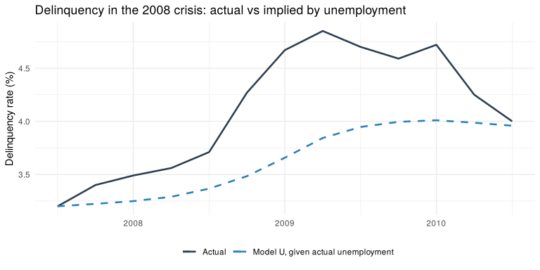
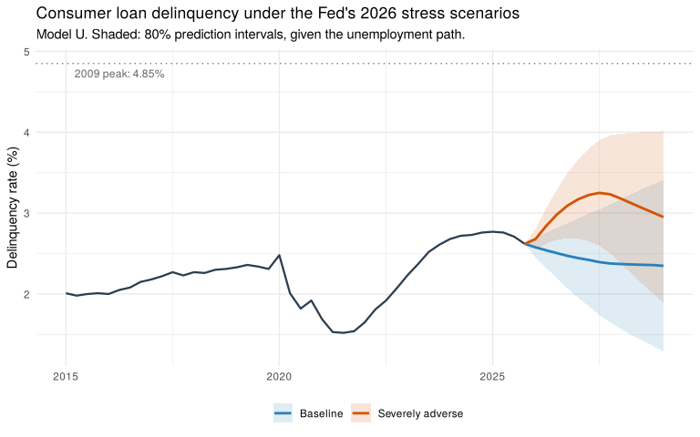

Consumer Loan Delinquency Forecasting: Macroeconomic Models and the
Fed’s 2026 Stress Scenarios
================
Farida Issifou
2026-10-27

------------------------------------------------------------------------

This last step answers two questions:

1.  **Do macroeconomic indicators improve delinquency forecasts**
    compared with the ARIMA(1,1,1) baseline of step 3, in particular
    during crises?
2.  **What would the Federal Reserve’s 2026 stress-test scenarios mean
    for consumer loan delinquency** through 2029 Q1?

The notebook (1) estimates a model for the change in delinquency with
the predictors selected in step 2, (2) reduces it to the variables that
matter, (3) compares it with the baseline on out-of-sample forecasts,
(4) checks it against the 2008 crisis, and (5) forecasts delinquency
under the Fed’s baseline and severely adverse scenarios.

------------------------------------------------------------------------

## Setup

``` r
library(forecast)
library(ggplot2)
library(readr)
library(knitr)
library(kableExtra)
```

``` r
show_table <- function(df, caption = NULL) {
  kable(df, caption = caption, align = "l", row.names = FALSE) |>
    kable_styling(bootstrap_options = c("striped", "condensed"), full_width = FALSE)
}

# Regression with ARIMA(1,1,1) errors, written in levels: the regressors enter as
# cumulative sums, so the model for the change in delinquency is
#   Δdlq_t = b'X_t + ARMA(1,1) error,
# i.e. the step 3 baseline plus macro predictors. Fallback to ML if CSS-ML fails.
fit_macro <- function(y, X, drift = FALSE) {
  CX <- apply(X, 2, cumsum)
  tryCatch(Arima(y, order = c(1, 1, 1), xreg = CX, include.drift = drift),
           error = function(e) Arima(y, order = c(1, 1, 1), xreg = CX,
                                     include.drift = drift, method = "ML"))
}

# Forecast levels given the future values of the regressors (X_future)
forecast_macro <- function(fit, X_in, X_future, level = 80) {
  CX_f <- X_future
  for (j in seq_len(ncol(X_future))) CX_f[, j] <- sum(X_in[, j]) + cumsum(X_future[, j])
  forecast(fit, xreg = CX_f, level = level)
}

coef_table <- function(fit, labels) {
  b  <- coef(fit)[names(labels)]
  se <- sqrt(diag(fit$var.coef))[names(labels)]
  p  <- 2 * pnorm(-abs(b / se))
  data.frame(Variable = unname(labels), Coefficient = round(b, 3),
             `Std. error` = round(se, 3), `p-value` = round(p, 3), check.names = FALSE)
}

rmse <- function(e) sqrt(colMeans(e^2, na.rm = TRUE))
lag_x <- function(x, k) c(rep(NA, k), head(x, -k))
```

``` r
model_data <- read_csv("../data/model_data.csv", show_col_types = FALSE)
raw_data   <- read_csv("../data/data.csv", show_col_types = FALSE)

n       <- nrow(model_data)                                   # 1987 Q2 – 2025 Q4
quarter <- seq(1987.25, by = 0.25, length.out = n)
dlq     <- model_data$dlq

# Predictors with the lags chosen in step 2
X_all <- cbind(
  u0    = model_data$d_unemp,
  u1    = lag_x(model_data$d_unemp, 1),
  u2    = lag_x(model_data$d_unemp, 2),
  u3    = lag_x(model_data$d_unemp, 3),
  ffr1  = lag_x(model_data$d_ffr, 1),
  ys1   = lag_x(model_data$yspread, 1),
  conf0 = model_data$d_conf)

labels_all <- c(u0 = "Δ unemployment (same quarter)", u1 = "Δ unemployment (1 quarter before)",
                u2 = "Δ unemployment (2 quarters before)", u3 = "Δ unemployment (3 quarters before)",
                ffr1 = "Δ fed funds rate (1 quarter before)", ys1 = "Yield spread (1 quarter before)",
                conf0 = "Δ consumer confidence (same quarter)")

# Pulse dummies for the first COVID quarters
pulse <- sapply(c(2020.25, 2020.5, 2020.75, 2021), function(t) as.numeric(abs(quarter - t) < 1e-6))
colnames(pulse) <- c("p2020q2", "p2020q3", "p2020q4", "p2021q1")

est <- 5:n   # estimation sample starts in 1988 Q2, once all lags exist
```

The estimation sample runs from 1988 Q2 to 2025 Q4 (151 quarters): the
first four quarters are lost to the lags of unemployment.

------------------------------------------------------------------------

## 1. Full Model

We model the **change in delinquency** with the predictors and lags
selected in step 2, and keep the ARMA(1,1) error structure of the step 3
baseline. The model is therefore the baseline ARIMA(1,1,1) plus
macroeconomic predictors, so any gain in accuracy comes from the macro
variables.

COVID-19 needs a treatment here. In 2020 Q2 unemployment rose by 9
points while delinquency fell, because of stimulus payments and loan
forbearance. Left in, this quarter would teach the model that higher
unemployment lowers delinquency. As planned in step 3, we add **pulse
dummies** for 2020 Q2 to 2021 Q1, the four quarters in which the 2020
jump in unemployment enters the model through its lags.

``` r
X_full <- X_all[est, ]
fit_nopulse <- fit_macro(dlq[est], X_full, drift = TRUE)
fit_full    <- fit_macro(dlq[est], cbind(X_full, pulse[est, ]), drift = TRUE)

cat("AICc without pulse dummies:", round(fit_nopulse$aicc, 1),
    "| with pulse dummies:", round(fit_full$aicc, 1), "\n")
```

    ## AICc without pulse dummies: -250.2 | with pulse dummies: -263

``` r
show_table(coef_table(fit_full, labels_all),
           caption = "Full model: change in delinquency, ARMA(1,1) errors, COVID pulse dummies")
```

<table class="table table-striped table-condensed" style="width: auto !important; margin-left: auto; margin-right: auto;">
<caption>
Full model: change in delinquency, ARMA(1,1) errors, COVID pulse dummies
</caption>
<thead>
<tr>
<th style="text-align:left;">
Variable
</th>
<th style="text-align:left;">
Coefficient
</th>
<th style="text-align:left;">
Std. error
</th>
<th style="text-align:left;">
p-value
</th>
</tr>
</thead>
<tbody>
<tr>
<td style="text-align:left;">
Δ unemployment (same quarter)
</td>
<td style="text-align:left;">
0.060
</td>
<td style="text-align:left;">
0.043
</td>
<td style="text-align:left;">
0.163
</td>
</tr>
<tr>
<td style="text-align:left;">
Δ unemployment (1 quarter before)
</td>
<td style="text-align:left;">
0.079
</td>
<td style="text-align:left;">
0.041
</td>
<td style="text-align:left;">
0.052
</td>
</tr>
<tr>
<td style="text-align:left;">
Δ unemployment (2 quarters before)
</td>
<td style="text-align:left;">
0.003
</td>
<td style="text-align:left;">
0.040
</td>
<td style="text-align:left;">
0.941
</td>
</tr>
<tr>
<td style="text-align:left;">
Δ unemployment (3 quarters before)
</td>
<td style="text-align:left;">
0.003
</td>
<td style="text-align:left;">
0.027
</td>
<td style="text-align:left;">
0.919
</td>
</tr>
<tr>
<td style="text-align:left;">
Δ fed funds rate (1 quarter before)
</td>
<td style="text-align:left;">
-0.011
</td>
<td style="text-align:left;">
0.025
</td>
<td style="text-align:left;">
0.668
</td>
</tr>
<tr>
<td style="text-align:left;">
Yield spread (1 quarter before)
</td>
<td style="text-align:left;">
-0.060
</td>
<td style="text-align:left;">
0.016
</td>
<td style="text-align:left;">
0.000
</td>
</tr>
<tr>
<td style="text-align:left;">
Δ consumer confidence (same quarter)
</td>
<td style="text-align:left;">
-0.002
</td>
<td style="text-align:left;">
0.001
</td>
<td style="text-align:left;">
0.220
</td>
</tr>
</tbody>
</table>

- The pulse dummies improve the fit clearly (lower AICc), so they are
  kept.
- **Unemployment matters in the same quarter and the quarter before**;
  its effect disappears at lags 2 and 3.
- **The yield spread is strongly significant, with a negative sign**: a
  steeper curve is followed by falling delinquency. This is the pattern
  seen in step 2 (delinquency leads the spread): the curve steepens when
  the Fed cuts rates after a credit shock, at the time delinquency
  starts to recover.
- The fed funds rate and consumer confidence add nothing once
  unemployment and the spread are included.

------------------------------------------------------------------------

## 2. Reduced Models

We drop the insignificant variables and keep two candidates:

- **Model U:** change in unemployment, same quarter and one quarter
  before.
- **Model U + S:** the same plus the yield spread (one quarter before).

Model U has no constant, exactly like the baseline. Model U + S needs
one, since the spread enters in levels.

``` r
vars_u  <- c("u0", "u1")
vars_us <- c("u0", "u1", "ys1")

fit_u  <- fit_macro(dlq[est], cbind(X_all[est, vars_u],  pulse[est, ]))
fit_us <- fit_macro(dlq[est], cbind(X_all[est, vars_us], pulse[est, ]), drift = TRUE)

show_table(rbind(cbind(Model = "U", coef_table(fit_u, labels_all[vars_u])),
                 cbind(Model = "U + S", coef_table(fit_us, labels_all[vars_us]))),
           caption = "Reduced models (pulse dummies not shown)")
```

<table class="table table-striped table-condensed" style="width: auto !important; margin-left: auto; margin-right: auto;">
<caption>
Reduced models (pulse dummies not shown)
</caption>
<thead>
<tr>
<th style="text-align:left;">
Model
</th>
<th style="text-align:left;">
Variable
</th>
<th style="text-align:left;">
Coefficient
</th>
<th style="text-align:left;">
Std. error
</th>
<th style="text-align:left;">
p-value
</th>
</tr>
</thead>
<tbody>
<tr>
<td style="text-align:left;">
U
</td>
<td style="text-align:left;">
Δ unemployment (same quarter)
</td>
<td style="text-align:left;">
0.078
</td>
<td style="text-align:left;">
0.044
</td>
<td style="text-align:left;">
0.074
</td>
</tr>
<tr>
<td style="text-align:left;">
U
</td>
<td style="text-align:left;">
Δ unemployment (1 quarter before)
</td>
<td style="text-align:left;">
0.075
</td>
<td style="text-align:left;">
0.040
</td>
<td style="text-align:left;">
0.062
</td>
</tr>
<tr>
<td style="text-align:left;">
U + S
</td>
<td style="text-align:left;">
Δ unemployment (same quarter)
</td>
<td style="text-align:left;">
0.069
</td>
<td style="text-align:left;">
0.041
</td>
<td style="text-align:left;">
0.090
</td>
</tr>
<tr>
<td style="text-align:left;">
U + S
</td>
<td style="text-align:left;">
Δ unemployment (1 quarter before)
</td>
<td style="text-align:left;">
0.078
</td>
<td style="text-align:left;">
0.039
</td>
<td style="text-align:left;">
0.046
</td>
</tr>
<tr>
<td style="text-align:left;">
U + S
</td>
<td style="text-align:left;">
Yield spread (1 quarter before)
</td>
<td style="text-align:left;">
-0.059
</td>
<td style="text-align:left;">
0.015
</td>
<td style="text-align:left;">
0.000
</td>
</tr>
</tbody>
</table>

``` r
b_sum  <- sum(coef(fit_u)[vars_u])
se_sum <- sqrt(sum(fit_u$var.coef[vars_u, vars_u]))
cat("Model U, total effect of unemployment:", round(b_sum, 3),
    "| p-value:", signif(2 * pnorm(-abs(b_sum / se_sum)), 2), "\n")
```

    ## Model U, total effect of unemployment: 0.153 | p-value: 0.003

Each unemployment coefficient is only borderline on its own, because the
two quarters are correlated, but their **sum is clearly significant**.
In Model U, a 1-point rise in unemployment raises delinquency by about
0.15 points over two quarters. Because the model is in differences, this
effect is permanent: delinquency stays higher until unemployment falls
again.

------------------------------------------------------------------------

## 3. Do Macro Predictors Improve the Forecasts?

We use the rolling-origin scheme of step 3: from 2004 Q4, each model is
re-estimated on the data available at each quarter and forecasts the
next 1 to 4 quarters. The baseline ARIMA(1,1,1) is re-run in the same
loop.

A multivariate model also needs the **future values of its predictors**.
We evaluate it in two ways:

- **Known macro path:** the predictors take their actual values. This
  measures how well the model translates a given path of unemployment
  into delinquency, which is exactly how it is used in a stress test.
- **Real time:** the predictors are themselves forecast with ARIMA
  models (selected by `auto.arima`) estimated on data up to the origin.
  This is what a forecaster would actually have known.

The pulse dummies are set to zero in the forecast period, since nobody
could have anticipated the COVID support measures.

``` r
first_origin <- which(quarter == 2004.75)

rolling_errors <- function(vars = NULL, drift = FALSE, real_time = FALSE) {
  E <- matrix(NA, n, 4)
  for (o in first_origin:(n - 1)) {
    h <- min(4, n - o)
    target <- (o + 1):(o + h)
    actual <- dlq[target]

    if (is.null(vars)) {                               # baseline ARIMA(1,1,1)
      fit <- tryCatch(Arima(dlq[1:o], order = c(1, 1, 1)),
                      error = function(e) Arima(dlq[1:o], order = c(1, 1, 1), method = "ML"))
      E[o, 1:h] <- actual - forecast(fit, h = h)$mean
      next
    }

    idx <- est[est <= o]
    P   <- pulse[, colSums(pulse[idx, , drop = FALSE]) > 0, drop = FALSE]  # dummies observed so far
    X   <- cbind(X_all[, vars, drop = FALSE], P)
    X_f <- X[target, , drop = FALSE]
    X_f[, colnames(P)] <- 0

    if (real_time) {                                   # replace future predictors by forecasts
      u  <- c(model_data$d_unemp[1:o], forecast(auto.arima(model_data$d_unemp[1:o]), h = h)$mean)
      ys <- c(model_data$yspread[1:o], forecast(auto.arima(model_data$yspread[1:o]), h = h)$mean)
      X_f[, "u0"] <- u[target]
      X_f[, "u1"] <- u[target - 1]
      if ("ys1" %in% vars) X_f[, "ys1"] <- ys[target - 1]
    }

    fit <- fit_macro(dlq[idx], X[idx, , drop = FALSE], drift = drift)
    E[o, 1:h] <- actual - forecast_macro(fit, X[idx, , drop = FALSE], X_f)$mean
  }
  E
}

err_base   <- rolling_errors()
err_u      <- rolling_errors(vars_u)
err_us     <- rolling_errors(vars_us, drift = TRUE)
err_u_rt   <- rolling_errors(vars_u, real_time = TRUE)
err_us_rt  <- rolling_errors(vars_us, drift = TRUE, real_time = TRUE)
```

### 3.1 Overall Accuracy

``` r
model_names <- c("Baseline ARIMA(1,1,1)", "Model U", "Model U + S")
rmse_table <- function(errs) {
  out <- data.frame(Model = model_names, round(t(sapply(errs, rmse)), 3))
  names(out)[2:5] <- paste(1:4, c("quarter", rep("quarters", 3)), "ahead")
  out
}
show_table(rmse_table(list(err_base, err_u, err_us)),
           caption = "RMSE (pp), known macro path, all forecasts 2005 – 2025")
```

<table class="table table-striped table-condensed" style="width: auto !important; margin-left: auto; margin-right: auto;">
<caption>
RMSE (pp), known macro path, all forecasts 2005 – 2025
</caption>
<thead>
<tr>
<th style="text-align:left;">
Model
</th>
<th style="text-align:left;">
1 quarter ahead
</th>
<th style="text-align:left;">
2 quarters ahead
</th>
<th style="text-align:left;">
3 quarters ahead
</th>
<th style="text-align:left;">
4 quarters ahead
</th>
</tr>
</thead>
<tbody>
<tr>
<td style="text-align:left;">
Baseline ARIMA(1,1,1)
</td>
<td style="text-align:left;">
0.130
</td>
<td style="text-align:left;">
0.231
</td>
<td style="text-align:left;">
0.322
</td>
<td style="text-align:left;">
0.419
</td>
</tr>
<tr>
<td style="text-align:left;">
Model U
</td>
<td style="text-align:left;">
0.219
</td>
<td style="text-align:left;">
0.343
</td>
<td style="text-align:left;">
0.423
</td>
<td style="text-align:left;">
0.510
</td>
</tr>
<tr>
<td style="text-align:left;">
Model U + S
</td>
<td style="text-align:left;">
0.223
</td>
<td style="text-align:left;">
0.352
</td>
<td style="text-align:left;">
0.435
</td>
<td style="text-align:left;">
0.522
</td>
</tr>
</tbody>
</table>

Over all forecasts, **both macro models are clearly worse than the
baseline**. The errors are concentrated in 2020: knowing that
unemployment jumped by 9 points, the models forecast a surge in
delinquency, while it actually fell. During COVID-19, policy support
broke the usual link between job losses and missed payments.

Since that link is what a stress test relies on, and no stress scenario
assumes pandemic-style support, we compare the models **excluding the
forecasts that target the emergency support period** (2020 Q2 to 2021
Q4, the window used for the COVID dummy in step 3).

``` r
drop_support <- function(E) {
  for (o in seq_len(n)) for (k in 1:4)
    if (o + k <= n && quarter[o + k] >= 2020.25 && quarter[o + k] <= 2021.75) E[o, k] <- NA
  E
}
show_table(rmse_table(lapply(list(err_base, err_u, err_us), drop_support)),
           caption = "RMSE (pp), known macro path, excluding targets in 2020 Q2 – 2021 Q4")
```

<table class="table table-striped table-condensed" style="width: auto !important; margin-left: auto; margin-right: auto;">
<caption>
RMSE (pp), known macro path, excluding targets in 2020 Q2 – 2021 Q4
</caption>
<thead>
<tr>
<th style="text-align:left;">
Model
</th>
<th style="text-align:left;">
1 quarter ahead
</th>
<th style="text-align:left;">
2 quarters ahead
</th>
<th style="text-align:left;">
3 quarters ahead
</th>
<th style="text-align:left;">
4 quarters ahead
</th>
</tr>
</thead>
<tbody>
<tr>
<td style="text-align:left;">
Baseline ARIMA(1,1,1)
</td>
<td style="text-align:left;">
0.113
</td>
<td style="text-align:left;">
0.213
</td>
<td style="text-align:left;">
0.315
</td>
<td style="text-align:left;">
0.411
</td>
</tr>
<tr>
<td style="text-align:left;">
Model U
</td>
<td style="text-align:left;">
0.112
</td>
<td style="text-align:left;">
0.213
</td>
<td style="text-align:left;">
0.317
</td>
<td style="text-align:left;">
0.405
</td>
</tr>
<tr>
<td style="text-align:left;">
Model U + S
</td>
<td style="text-align:left;">
0.109
</td>
<td style="text-align:left;">
0.206
</td>
<td style="text-align:left;">
0.304
</td>
<td style="text-align:left;">
0.383
</td>
</tr>
</tbody>
</table>

Outside the support period, the gains are small. Model U is about as
accurate as the baseline, and Model U + S lowers the 4-quarter error by
about 7%.

### 3.2 Crisis Periods

``` r
period <- ifelse(quarter >= 2007.5 & quarter < 2011, "2008–2010 crisis",
          ifelse(quarter >= 2019.75 & quarter < 2022.5, "COVID-19", "Normal periods"))
rmse_4q <- function(E) tapply(drop_support(E)[, 4], period,
                              function(x) sqrt(mean(x^2, na.rm = TRUE)))
by_period <- sapply(list(err_base, err_u, err_us), rmse_4q)[c("Normal periods", "2008–2010 crisis", "COVID-19"), ]

show_table(data.frame(Model = model_names, round(t(by_period), 3), check.names = FALSE),
           caption = "RMSE 4 quarters ahead by period of the forecast origin, known macro path, excluding support-period targets")
```

<table class="table table-striped table-condensed" style="width: auto !important; margin-left: auto; margin-right: auto;">
<caption>
RMSE 4 quarters ahead by period of the forecast origin, known macro
path, excluding support-period targets
</caption>
<thead>
<tr>
<th style="text-align:left;">
Model
</th>
<th style="text-align:left;">
Normal periods
</th>
<th style="text-align:left;">
2008–2010 crisis
</th>
<th style="text-align:left;">
COVID-19
</th>
</tr>
</thead>
<tbody>
<tr>
<td style="text-align:left;">
Baseline ARIMA(1,1,1)
</td>
<td style="text-align:left;">
0.201
</td>
<td style="text-align:left;">
0.805
</td>
<td style="text-align:left;">
0.456
</td>
</tr>
<tr>
<td style="text-align:left;">
Model U
</td>
<td style="text-align:left;">
0.193
</td>
<td style="text-align:left;">
0.774
</td>
<td style="text-align:left;">
0.543
</td>
</tr>
<tr>
<td style="text-align:left;">
Model U + S
</td>
<td style="text-align:left;">
0.220
</td>
<td style="text-align:left;">
0.696
</td>
<td style="text-align:left;">
0.493
</td>
</tr>
</tbody>
</table>

The macro models help **most in the 2008–2010 crisis**, where Model U +
S cuts the baseline error by about 14%. Even so, the crisis error
remains three times the normal-period error. (The COVID-19 row now only
covers forecasts of the recovery from 2022 on.)

``` r
dm_p <- function(E1, E2) {
  e <- cbind(drop_support(E1)[, 4], drop_support(E2)[, 4])
  e <- e[complete.cases(e), ]
  round(dm.test(e[, 1], e[, 2], h = 4)$p.value, 2)
}
cat("Diebold-Mariano p-value, 4 quarters ahead, vs baseline: Model U =", dm_p(err_base, err_u),
    "| Model U + S =", dm_p(err_base, err_us), "\n")
```

    ## Diebold-Mariano p-value, 4 quarters ahead, vs baseline: Model U = 0.76 | Model U + S = 0.64

Neither improvement is statistically significant.

### 3.3 Real-Time Forecasts

``` r
show_table(rmse_table(lapply(list(err_base, err_u_rt, err_us_rt), drop_support)),
           caption = "RMSE (pp), real time (predictors forecast), excluding support-period targets")
```

<table class="table table-striped table-condensed" style="width: auto !important; margin-left: auto; margin-right: auto;">
<caption>
RMSE (pp), real time (predictors forecast), excluding support-period
targets
</caption>
<thead>
<tr>
<th style="text-align:left;">
Model
</th>
<th style="text-align:left;">
1 quarter ahead
</th>
<th style="text-align:left;">
2 quarters ahead
</th>
<th style="text-align:left;">
3 quarters ahead
</th>
<th style="text-align:left;">
4 quarters ahead
</th>
</tr>
</thead>
<tbody>
<tr>
<td style="text-align:left;">
Baseline ARIMA(1,1,1)
</td>
<td style="text-align:left;">
0.113
</td>
<td style="text-align:left;">
0.213
</td>
<td style="text-align:left;">
0.315
</td>
<td style="text-align:left;">
0.411
</td>
</tr>
<tr>
<td style="text-align:left;">
Model U
</td>
<td style="text-align:left;">
0.112
</td>
<td style="text-align:left;">
0.215
</td>
<td style="text-align:left;">
0.319
</td>
<td style="text-align:left;">
0.417
</td>
</tr>
<tr>
<td style="text-align:left;">
Model U + S
</td>
<td style="text-align:left;">
0.110
</td>
<td style="text-align:left;">
0.210
</td>
<td style="text-align:left;">
0.315
</td>
<td style="text-align:left;">
0.413
</td>
</tr>
</tbody>
</table>

When the future path of the predictors has to be forecast too, the small
gain disappears: the macro models are **no better than the baseline**.
Unemployment moves at the same time as delinquency or one quarter
before, so it gives no lead time, and forecasting unemployment is as
hard as forecasting delinquency.

**Conclusion of the evaluation:** as an early-warning tool, macro data
adds little to delinquency’s own momentum. The value of the macro model
lies elsewhere: it is the only one of the two models that can answer
*“what happens to delinquency if unemployment follows this path?”*,
which is the question a stress test asks.

------------------------------------------------------------------------

## 4. A Check Against 2008

Before using the model on a stress scenario, we check how much of the
2008 crisis it explains. Starting from 2007 Q3, we feed Model U
(estimated on the full sample) the actual path of unemployment and
compute the change in delinquency it implies over the next three years.

``` r
o   <- which(quarter == 2007.5)
t   <- (o + 1):(o + 12)
sim <- dlq[o] + cumsum(X_all[t, vars_u] %*% coef(fit_u)[vars_u])

df_2008 <- data.frame(t = c(quarter[o], quarter[t]), actual = dlq[c(o, t)], model = c(dlq[o], sim))
ggplot(df_2008, aes(t)) +
  geom_line(aes(y = actual, colour = "Actual"), linewidth = 0.9) +
  geom_line(aes(y = model, colour = "Model U, given actual unemployment"), linewidth = 0.9, linetype = "dashed") +
  scale_colour_manual(values = c("Actual" = "#2c3e50", "Model U, given actual unemployment" = "#2980b9")) +
  labs(title = "Delinquency in the 2008 crisis: actual vs implied by unemployment",
       x = NULL, y = "Delinquency rate (%)", colour = NULL) +
  theme_minimal() + theme(legend.position = "bottom")
```

<!-- -->

``` r
peak_actual <- max(dlq[t]) - dlq[o]
peak_model  <- max(sim) - dlq[o]
```

Delinquency rose by 1.65 points from 2007 Q3 to its 2009 peak. Given the
actual rise in unemployment, the model explains 0.81 points, about
**49%** of it. It also misses the timing: delinquency started rising in
2007, before unemployment, because the crisis began in mortgage and
consumer credit rather than in the labour market. The unemployment
channel therefore gives a **lower bound** for a crisis that also
involves a housing and credit shock.

------------------------------------------------------------------------

## 5. Delinquency Under the Fed’s 2026 Stress Scenarios

The Federal Reserve published its final 2026 supervisory scenarios in
February 2026. They cover 13 quarters, 2026 Q1 to 2029 Q1, starting from
2025 Q4:

- **Baseline:** unemployment stays near 4.5% and edges down to 4.2%.
- **Severely adverse:** a severe global recession. Unemployment rises
  from 4.5% to a peak of **10% in 2027 Q3**, house prices fall by about
  30%, and the Fed cuts the 3-month rate to 0.1%.

The scenario files are saved in `data/fed_2026/` (source:
[federalreserve.gov](https://www.federalreserve.gov/supervisionreg/dfa-stress-tests-2026.htm)).

``` r
read_scenario <- function(file, name) {
  s <- read.csv(file, check.names = FALSE)
  unemp <- c(4.5, s[["Unemployment rate"]])        # 2025 Q4 jump-off value from the Fed
  data.frame(scenario = name, date = s$Date,
             t = seq(2026, by = 0.25, length.out = nrow(s)),
             unemployment = s[["Unemployment rate"]],
             d_unemp = diff(unemp))
}
scen <- rbind(read_scenario("../data/fed_2026/baseline_domestic.csv", "Baseline"),
              read_scenario("../data/fed_2026/severely_adverse_domestic.csv", "Severely adverse"))
```

**Which model?** We use **Model U** for the scenarios and not Model U +
S, for two reasons:

- The two models forecast almost equally well in real time (section
  3.3).
- The yield spread effect does not carry over to a stress scenario.
  Historically, a steep curve meant that the Fed had already cut rates
  and the recovery was under way. In the severely adverse scenario, the
  curve steepens immediately because the Fed cuts rates at the start of
  the recession. Model U + S would read this as a signal of recovery: it
  would make delinquency fall back below its baseline level by 2029
  while unemployment is still 8%.

The scenario path of unemployment is translated into the model’s
predictors (change in unemployment, same quarter and one quarter
before), and the pulse dummies are set to zero.

``` r
X_in <- cbind(X_all[est, vars_u], pulse[est, ])
scenario_forecast <- function(s) {
  X_f <- cbind(u0 = s$d_unemp, u1 = c(model_data$d_unemp[n], head(s$d_unemp, -1)),
               matrix(0, nrow(s), ncol(pulse), dimnames = list(NULL, colnames(pulse))))
  fc <- forecast_macro(fit_u, X_in, X_f, level = 80)
  data.frame(s, forecast = as.numeric(fc$mean),
             lo80 = as.numeric(fc$lower), hi80 = as.numeric(fc$upper))
}
fc_scen <- do.call(rbind, lapply(split(scen, scen$scenario), scenario_forecast))
```

``` r
hist_df <- data.frame(t = quarter[quarter >= 2015], y = dlq[quarter >= 2015])
start_pt <- data.frame(t = quarter[n], forecast = dlq[n], lo80 = dlq[n], hi80 = dlq[n],
                       scenario = c("Baseline", "Severely adverse"))
plot_df <- rbind(start_pt, fc_scen[, names(start_pt)])
cols <- c("Baseline" = "#2980b9", "Severely adverse" = "#d35400")

ggplot(plot_df, aes(t)) +
  geom_ribbon(aes(ymin = lo80, ymax = hi80, fill = scenario), alpha = 0.15) +
  geom_line(data = hist_df, aes(t, y), colour = "#2c3e50", linewidth = 0.8) +
  geom_line(aes(y = forecast, colour = scenario), linewidth = 1) +
  geom_hline(yintercept = max(dlq), linetype = "dotted", colour = "grey50") +
  annotate("text", x = 2015.2, y = max(dlq) - 0.12, hjust = 0, size = 3.2, colour = "grey40",
           label = sprintf("2009 peak: %.2f%%", max(dlq))) +
  scale_colour_manual(values = cols) + scale_fill_manual(values = cols) +
  labs(title = "Consumer loan delinquency under the Fed's 2026 stress scenarios",
       subtitle = "Model U. Shaded: 80% prediction intervals, given the unemployment path.",
       x = NULL, y = "Delinquency rate (%)", colour = NULL, fill = NULL) +
  theme_minimal() + theme(legend.position = "bottom")
```

<!-- -->

``` r
wide <- reshape(fc_scen[, c("date", "scenario", "unemployment", "forecast")],
                idvar = "date", timevar = "scenario", direction = "wide")
show_table(data.frame(
  Quarter = wide$date,
  `Unemployment, baseline (%)` = wide$unemployment.Baseline,
  `Delinquency, baseline (%)` = round(wide$forecast.Baseline, 2),
  `Unemployment, severely adverse (%)` = wide[["unemployment.Severely adverse"]],
  `Delinquency, severely adverse (%)` = round(wide[["forecast.Severely adverse"]], 2),
  check.names = FALSE),
  caption = "Delinquency forecasts under the Fed's 2026 scenarios")
```

<table class="table table-striped table-condensed" style="width: auto !important; margin-left: auto; margin-right: auto;">
<caption>
Delinquency forecasts under the Fed’s 2026 scenarios
</caption>
<thead>
<tr>
<th style="text-align:left;">
Quarter
</th>
<th style="text-align:left;">
Unemployment, baseline (%)
</th>
<th style="text-align:left;">
Delinquency, baseline (%)
</th>
<th style="text-align:left;">
Unemployment, severely adverse (%)
</th>
<th style="text-align:left;">
Delinquency, severely adverse (%)
</th>
</tr>
</thead>
<tbody>
<tr>
<td style="text-align:left;">
2026 Q1
</td>
<td style="text-align:left;">
4.6
</td>
<td style="text-align:left;">
2.58
</td>
<td style="text-align:left;">
5.9
</td>
<td style="text-align:left;">
2.68
</td>
</tr>
<tr>
<td style="text-align:left;">
2026 Q2
</td>
<td style="text-align:left;">
4.6
</td>
<td style="text-align:left;">
2.54
</td>
<td style="text-align:left;">
7.2
</td>
<td style="text-align:left;">
2.84
</td>
</tr>
<tr>
<td style="text-align:left;">
2026 Q3
</td>
<td style="text-align:left;">
4.6
</td>
<td style="text-align:left;">
2.51
</td>
<td style="text-align:left;">
8.2
</td>
<td style="text-align:left;">
2.98
</td>
</tr>
<tr>
<td style="text-align:left;">
2026 Q4
</td>
<td style="text-align:left;">
4.5
</td>
<td style="text-align:left;">
2.47
</td>
<td style="text-align:left;">
9.0
</td>
<td style="text-align:left;">
3.09
</td>
</tr>
<tr>
<td style="text-align:left;">
2027 Q1
</td>
<td style="text-align:left;">
4.5
</td>
<td style="text-align:left;">
2.44
</td>
<td style="text-align:left;">
9.5
</td>
<td style="text-align:left;">
3.17
</td>
</tr>
<tr>
<td style="text-align:left;">
2027 Q2
</td>
<td style="text-align:left;">
4.4
</td>
<td style="text-align:left;">
2.42
</td>
<td style="text-align:left;">
9.9
</td>
<td style="text-align:left;">
3.22
</td>
</tr>
<tr>
<td style="text-align:left;">
2027 Q3
</td>
<td style="text-align:left;">
4.3
</td>
<td style="text-align:left;">
2.39
</td>
<td style="text-align:left;">
10.0
</td>
<td style="text-align:left;">
3.25
</td>
</tr>
<tr>
<td style="text-align:left;">
2027 Q4
</td>
<td style="text-align:left;">
4.3
</td>
<td style="text-align:left;">
2.38
</td>
<td style="text-align:left;">
9.8
</td>
<td style="text-align:left;">
3.23
</td>
</tr>
<tr>
<td style="text-align:left;">
2028 Q1
</td>
<td style="text-align:left;">
4.3
</td>
<td style="text-align:left;">
2.37
</td>
<td style="text-align:left;">
9.4
</td>
<td style="text-align:left;">
3.18
</td>
</tr>
<tr>
<td style="text-align:left;">
2028 Q2
</td>
<td style="text-align:left;">
4.3
</td>
<td style="text-align:left;">
2.37
</td>
<td style="text-align:left;">
9.1
</td>
<td style="text-align:left;">
3.12
</td>
</tr>
<tr>
<td style="text-align:left;">
2028 Q3
</td>
<td style="text-align:left;">
4.3
</td>
<td style="text-align:left;">
2.36
</td>
<td style="text-align:left;">
8.7
</td>
<td style="text-align:left;">
3.06
</td>
</tr>
<tr>
<td style="text-align:left;">
2028 Q4
</td>
<td style="text-align:left;">
4.3
</td>
<td style="text-align:left;">
2.36
</td>
<td style="text-align:left;">
8.4
</td>
<td style="text-align:left;">
3.01
</td>
</tr>
<tr>
<td style="text-align:left;">
2029 Q1
</td>
<td style="text-align:left;">
4.2
</td>
<td style="text-align:left;">
2.35
</td>
<td style="text-align:left;">
8.0
</td>
<td style="text-align:left;">
2.95
</td>
</tr>
</tbody>
</table>

``` r
sa <- fc_scen[fc_scen$scenario == "Severely adverse", ]
bl <- fc_scen[fc_scen$scenario == "Baseline", ]
peak <- which.max(sa$forecast)
```

- **Baseline:** delinquency continues its slow decline, to about 2.35%
  in 2029 Q1, slightly below the univariate baseline of step 3 (2.45% at
  the end of 2027), since unemployment edges down.
- **Severely adverse:** delinquency rises from 2.62% to a peak of
  **3.25% in 2027 Q3**, 0.86 points above the baseline. It peaks with
  unemployment and is still 0.6 points above the baseline at the end of
  the scenario.
- **This is likely an underestimate.** The scenario combines a 5.5-point
  rise in unemployment with a 30% fall in house prices, a shock similar
  to 2008. In 2008, the unemployment channel explained only about 49% of
  the rise in delinquency (section 4). Scaling the rise by the same
  ratio would put the peak near 3.9%, an increase of about 1.3 points,
  comparable to 2008 but from a lower starting level (the 2009 record
  was 4.85%).

------------------------------------------------------------------------

## Summary

- **Model:** the change in delinquency depends on the change in
  unemployment in the same and previous quarter (about +0.15 points of
  delinquency per point of unemployment), on top of the ARIMA(1,1,1)
  dynamics. The fed funds rate, consumer confidence and longer
  unemployment lags add nothing. The yield spread is significant but
  reflects the Fed’s reaction to credit stress.
- **Forecasting:** macro predictors do not improve real-time forecasts,
  and even with the actual unemployment path the gains are small and not
  significant. They help most in the 2008 crisis, but the error there
  stays three times the normal-period error. During COVID-19, policy
  support broke the unemployment-delinquency link entirely.
- **2008 check:** unemployment explains about 49% of the 2008–2009 rise
  in delinquency, and lags it.
- **Fed 2026 scenarios:** under the severely adverse scenario,
  delinquency would rise to about 3.3% by 2027 Q3 through the
  unemployment channel alone, and plausibly around 3.9% once the housing
  and credit shock is taken into account, a rise comparable to 2008.
  Under the baseline it keeps declining slowly.
